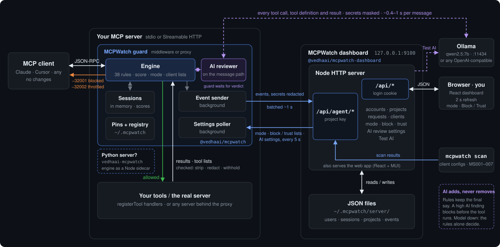

# MCPWatch Architecture

A guard inside your MCP server checks every JSON-RPC message in both directions: tool calls going in, tool lists and results coming out. A small Node dashboard stores what it saw and hands back your settings. A local AI model reviews each message alongside the rules.

See the [README](README.md) for setup, and for the full rule and option lists.

## The whole system



<details>
<summary>Same diagram as text</summary>

```
                              every tool call, tool definition and result
                              (the guard waits for the verdict, ~0.4–1 s)
                    ┌─────────────────────────────────────────────────────────────┐
                    │                                                             ▼
┌────────────┐   ┌──┴──────────── your MCP server ─────────────┐        ┌──────────────────┐
│ MCP client │   │ ┌──────── MCPWatch guard ─────────────────┐ │        │ Ollama :11434    │
│ Claude,    │──►│ │ Engine (38 rules, score,  ◄──► AI        │ │        │ qwen2.5:7b       │
│ Cursor, …  │◄──│ │ mode, lists)                  reviewer   │ │        └──────────────────┘
└────────────┘   │ │   ▲                                      │ │
 message /       │ │   ▼                Event sender ─────────┼─┼──► events, ~1 s ──┐
 −32001/−32002   │ │ Sessions           Settings poller ◄─────┼─┼─── settings, 5 s ─┤
                 │ │ (in memory)        Pins + registry       │ │                   │
                 │ └─────┬──────▲───────(~/.mcpwatch)─────────┘ │     ┌─────────────┴──────────────┐
                 │ allowed│      │results                       │     │ dashboard 127.0.0.1:9100   │
                 │       ▼      │                               │     │ /api/agent/*  project key  │◄── mcpwatch scan
                 │ ┌──────────────────────────────┐            │     │ /api/*        login cookie │◄─► browser (2 s refresh)
                 │ │ your tools / the real server │            │     │ JSON files in              │
                 │ └──────────────────────────────┘            │     │ ~/.mcpwatch/server/        │
                 └──────────────────────────────────────────────┘     └────────────────────────────┘
```

</details>

Unlike Headerwatch, the AI reviewer sits on the message path. The guard waits for its verdict, so a high AI finding can block a call before the tool runs. The two background links (events out, settings back) are the only connection to the dashboard. If the dashboard is down, the MCP server keeps working.

## Packages

The repo is an npm workspace. Each part has its own folder, package and tests:

| Folder | Package | Runs where | Depends on |
|---|---|---|---|
| [engine/](engine) | `@vedhaai/mcpwatch` (npm) | Inside your MCP server (middleware), as a proxy, or as a sidecar for Python | Nothing of MCPWatch's |
| [backend/](backend) | `@vedhaai/mcpwatch-dashboard` (npm) | Its own process: `npx @vedhaai/mcpwatch-dashboard` | The engine's public exports: the rule catalog, default policy and `AiReviewer` (for Test AI) |
| [frontend/](frontend) | private, not published | In the browser; its build goes into `backend/public/`, which the backend serves and ships | The backend's `/api/*` |
| [python/](python) | `vedhaai-mcpwatch` (PyPI) | Inside your Python MCP server | The engine, started as `mcpwatch engine` |

The engine never depends on the dashboard, so a guard works without one: events then go to `~/.mcpwatch/events.jsonl`.

## The parts

| Part | Code | What it does |
|---|---|---|
| **Guard** | [engine/src](engine/src): [engine.ts](engine/src/engine.ts), [rules.ts](engine/src/rules.ts), [state.ts](engine/src/state.ts), [transport.ts](engine/src/transport.ts) | One engine, three ways in (below). Runs the rules, keeps session state in memory, decides allow / throttle / block / strip / redact, and reports in the background. |
| **AI reviewer** | [ai.ts](engine/src/ai.ts) | Calls any OpenAI-compatible endpoint (Ollama by default) with the relevant slice of the rule catalog. Answers are checked, cached and merged into the rule findings. |
| **Dashboard** | [app.ts](backend/src/app.ts), [controllers/](backend/src/controllers), [services/](backend/src/services), [data/](backend/src/data), [cli.ts](backend/src/cli.ts), [frontend/](frontend) | `@vedhaai/mcpwatch-dashboard`, started with `mcpwatch-dashboard`. Express + tsoa server on 127.0.0.1:9100, in three layers: tsoa controllers (routes, auth, request validation; tsoa generates the Express routes and an OpenAPI spec into `src/generated/` at build time), services (the rules), and the data layer (JSON files). It serves the web app (React + TypeScript + MUI, built by Vite into `backend/public/`). `/api/agent/*` for guards (project key), `/api/*` for the page (login cookie). Stores everything as JSON files. |
| **Reporting** | [headerwatch.ts](engine/src/headerwatch.ts), [events.ts](engine/src/events.ts) | Batches events to `POST /api/agent/events` about once a second and polls `GET /api/agent/config` every 5 s. It uses the same agent API as Headerwatch, so a Headerwatch server works too. |
| **Scan** | [scan.ts](engine/src/scan.ts) | `mcpwatch scan` runs before any server starts. It checks the MCP server lists of Claude Desktop, Claude Code, Cursor, VS Code and Windsurf (MS001–MS007). |

### Five ways in

All five run the same `Engine`. Only the wrapping differs.

| Mode | File | Sits between | Use when |
|---|---|---|---|
| Middleware | [middleware.ts](engine/src/middleware.ts) | The SDK's protocol layer and its transport (`GuardedTransport`) | You own a Node/TypeScript server: add `mcpwatch(server)` before `connect()` |
| stdio proxy | [stdio-proxy.ts](engine/src/stdio-proxy.ts) | The client's stdin/stdout and a child process | A local server you can't edit (`npx …`) |
| HTTP proxy | [http-proxy.ts](engine/src/http-proxy.ts) | The client and a remote Streamable HTTP URL, including SSE streams | A remote server |
| Python middleware | [python/mcpwatch](python/mcpwatch), [engine-server.ts](engine/src/engine-server.ts) | The Python SDK's streams (stdio, SSE), or the HTTP layer (ASGI, WSGI, Django middleware) | You own a Python server: MCP SDK, Django, Flask, FastAPI |
| Java middleware | [java/src/main/java](java/src/main/java/ai/vedha/mcpwatch), [engine-server.ts](engine/src/engine-server.ts) | The Java SDK's transport provider and session, or the servlet chain | You own a Java server: MCP Java SDK, Spring Boot, Quarkus, Jetty, Tomcat |

**Python and Java.** Neither package re-implements the rules. Each starts `mcpwatch engine` as a child process: one engine per guarded server, with one JSON line per message each way. Both sides only move messages, so a Python or Java server gets exactly the verdicts a Node one would.

- **Python MCP SDK** (`mcpwatch(server)`): wraps the low-level `Server.run`, so stdio and SSE streams are checked, and wraps the app from `streamable_http_app()`.
- **Python HTTP adapters** ([http.py](python/mcpwatch/http.py), shared by ASGI, WSGI and Django): a port of the HTTP proxy's handling. They read the POST body, check JSON and SSE responses, and track session ids.
- **Java MCP SDK** (`McpWatch.guard(provider)`): wraps the transport provider. When the server registers its session factory, each new connection gets a guarded `McpServerTransport` (server → client) and a guarded `McpServerSession` (client → server). That covers stdio and HTTP+SSE.
- **Java servlet filter** ([McpWatchFilter](java/src/main/java/ai/vedha/mcpwatch/http/McpWatchFilter.java), over [HttpGuard](java/src/main/java/ai/vedha/mcpwatch/http/HttpGuard.java)): the same port of the HTTP proxy's handling as Python's, for Spring Boot, Quarkus, Jetty, Tomcat — and for Streamable HTTP, where the request headers the transport rules need are only available in the servlet chain.

If the engine can't start, the adapter's own `fail_open` / `failOpen` decides (default: pass messages unchecked). A guard error inside the Node engine follows the engine's `failOpen`, which defaults to refusing the request.

The Java package carries no dependencies of its own beyond SLF4J: the MCP SDK, Reactor and the servlet API are `provided`, and it brings [its own small JSON codec](java/src/main/java/ai/vedha/mcpwatch/Json.java) rather than force a Jackson version on the application it is injected into. Its checks are blocking, so each direction of each session runs them through a [Sequencer](java/src/main/java/ai/vedha/mcpwatch/sdk/Sequencer.java) off the transport thread — the Java form of the per-direction promise queue the Node and Python guards keep.

`Engine.fromClient` and `Engine.fromServer` are async because of the AI reviewer. Each wrapper keeps a promise queue per direction, so a slow review never lets a later message overtake an earlier one.

## One tool call, step by step

Everything here happens inside the guard, before your tool handler runs (`Engine.fromClient`).

1. **Queue in order.** The message waits for the one before it in the same direction.
2. **Find the session.** stdio: one session per connection. HTTP: the `Mcp-Session-Id`, else a hash of the caller's token, else one shared bucket.
3. **Transport rules (HTTP only).** MW030–MW036: foreign origin or host, missing auth, token passthrough, session hijacking, plain HTTP, impersonation, wrong token audience.
4. **Call rules.** These catch a denied or unknown tool, injection and traversal in arguments, a schema mismatch, secrets and a rug-pulled tool (MW001–MW010, MW024).
5. **Behaviour rules.** MB001–MB006 read the session: floods, enumeration, replays, a secret read followed by an outbound tool, another server's sensitive output.
6. **AI review, if on.** The model reports the rules the call breaks, or MA001 for anything else. Its findings are added; it can't remove one. If the model is down, the rules alone decide, unless the reviewer is required (MA002).
7. **Mode decides.**
   - `observe`: always allow.
   - `protect`: refuse high severity with `−32001`.
   - `enforce`: also throttle (`−32002`) at session score 3 and block at 6, within a 60 s window.
8. **Your lists override.** A blocked client is refused and a trusted client is allowed, in every mode.
9. **Forward and report.** Allowed calls reach your tool. Every non-trivial message is queued for the dashboard with a short, secret-redacted snippet.

## The way back

Messages from the server are checked in `Engine.fromServer`. The guard can only withhold or clean them, so `protect` and `enforce` act the same here.

| Message | Checked for | What the guard does |
|---|---|---|
| `tools/list` | Poisoning, invisible characters, shadowing, collisions, rug pulls against the pinned definition, AI review per tool | Strips the tool or cleans hidden characters. Each unchanged definition is reviewed only once (cached). |
| `tools/call` result | Prompt injection, secrets, the caller's own token, oversize, AI review | Withholds injections as an error result and redacts secrets |
| `resources/read`, `prompts/get` | Same as tool results | Same as tool results |
| `sampling/createMessage` | Always noted (MW026), injection in the prompt, AI review | Refused with a JSON-RPC error to the server when high |
| `elicitation/create` | Forms or links asking for passwords, keys or card details (MW029), AI review | Refused before the user sees it |
| `initialize` | Server name or version changed since it was pinned (MW038) | Reported only |

## The AI reviewer

[ai.ts](engine/src/ai.ts) and its wiring in `Engine.review`:

- **What it sees.** Each kind of message is reviewed against its own slice of the catalog, with a hint per rule:
  - tool calls: MW001–MW005 and MW010
  - tool definitions: MW020, MW021 and MW028
  - server output: MW022, MW025 and MW029
  - every kind also gets MA001

  The message is wrapped in randomly named `<untrusted-…>` tags. The model is told to treat the content as data.
- **What leaves the process.** Text with secrets masked and the caller's token removed, cut at 6,000 characters.
- **Answers are checked.**
  - The reply must be JSON.
  - A rule ID the model wasn't given becomes MA001.
  - A finding under 0.6 confidence counts one severity lower.
  - In `advise` mode, findings are capped at medium.
  - A "block" with no finding counts as a medium MA001.
- **Merge, never subtract.** AI findings are added unless the rules already raised the same rule at the same or higher severity. Rule findings are never removed. This matters because the payload being reviewed can address the model directly.
- **Cache and warm-up.** Answers are cached (LRU, 1,000 entries) by model, kind and content. The guard sends a tiny request when it starts or when AI is switched on, so the first real message doesn't wait for the model to load.
- **Failure.** On a timeout (default 8 s), an error or an answer that isn't JSON, the event records `ai.verdict: "error"` and the rules decide. With `required: true`, the message is blocked as MA002.

## The settings loop

When you change **AI review** (rules only, a local model, or a model with an API key), change the mode, or block a client:

| When | What happens |
|---|---|
| 0 s | The page sends `PATCH /api/projects/…` or posts to the client list. |
| 0 s | The dashboard writes `projects.json` and raises the project's settings version. |
| ≤ 5 s | The guard's poller reads `/api/agent/config`, and `policyFromConfig` passes the new settings to `engine.updatePolicy`. Turning AI on also warms up the model. |
| next message | The new settings apply. No restart. |

With a project key, the project's settings win over the guard's local options and environment (for example `MCPWATCH_MODE`, `MCPWATCH_AI`).

## Where things live

| What | Where | Notes |
|---|---|---|
| `:9100` | Dashboard | `npm start` (or `npx @vedhaai/mcpwatch-dashboard`), on 127.0.0.1 only |
| `:11434` | Ollama | `ollama serve` with `qwen2.5:7b`; any OpenAI-compatible server via `MCPWATCH_AI_URL` |
| `~/.mcpwatch/server/` | Dashboard data | `users.json`, `sessions.json`, `projects.json` (keys encrypted), `secret.key`, `events/<id>.jsonl` per project (rotated at 20 MB) |
| `~/.mcpwatch/pins.json` | Every guard | Pinned tool definitions and server versions; `mcpwatch pins reset` after a deliberate update |
| `~/.mcpwatch/registry.json` | Every guard | Tool names and a tool-list digest per server, and hashes of sensitive output lines for one hour (MW027, MW028, MB006) |
| `~/.mcpwatch/events.jsonl` | Guards without a key | Local event log, shown under Local events on the dashboard |
| `~/.mcpwatch/scan-baseline.json` | `mcpwatch scan` | The accepted configs, for MS006 tampering |
| memory | Each guard | Sessions, scores, call history, the AI cache. Reset on restart. |

## Limits of this proof of concept

- **Trust on first use, unless you tighten it.** By default the first definition seen for a tool is pinned and trusted, so a server that is malicious from the start is never flagged by MW024, and a changed server name or version (MW038) is reported once and then accepted. `strictPins` stops new tools being pinned, and `MCPWATCH_PINS_KEY` signs the pin and registry files. Without the key, the files are only owner-only: anything running as the same user can edit them.
- **One computer.** The dashboard listens on 127.0.0.1, so only guards on this machine can report to it.
- **Keys on disk.** Project keys and AI API keys are encrypted in `projects.json`, with `MCPWATCH_DATA_KEY` or a generated `secret.key` beside the file. The generated key only helps when the file leaves the folder by itself, not against anyone who can read the whole folder. Any guard with the project key receives the AI key with its settings, over plain HTTP on loopback. A guard refuses to send its key to a dashboard that is neither `https` nor loopback, and refuses settings that aren't signed with its project key once it has seen a signed answer (`MCPWATCH_REQUIRE_SIGNED=1` insists from the start).
- **JSON files, not a database.** Fine for a few projects. Many busy servers need real storage.
- **State per process.** Each guard keeps its own sessions and scores. Only pins and the registry are shared, through files.
- **The AI adds latency and misses things.** A 7B model takes about 0.4–1 s per reviewed message, longer while it loads. In testing it missed a metadata-URL SSRF that MW003 caught. That's why the rules keep the final say.
- **Polling, not streaming.** The page refreshes every 2 seconds and guards fetch settings every 5.
- **Python and Java servers need Node.** Both packages are thin adapters; the engine is the Node one. Each check is a round trip over a local pipe: about 0.3 ms on a laptop without AI review. Two adapters can't send a reply to the server for a refused server-to-client request (sampling, elicitation): Python's Django middleware and Java's servlet filter both drop the request and log it. Wrap the app with `McpWatchASGI` / `McpWatchWSGI`, or guard the Java SDK transport with `McpWatch.guard(provider)`, if your server sends those.
- **The Java SDK wrapper covers stdio and HTTP+SSE.** Streamable HTTP is guarded with the servlet filter instead. The wrapper also leans on `McpServerSession` being a non-final class with public methods: it is a delegating subclass, so a future SDK release that adds a public method to that class would need a matching override here.
